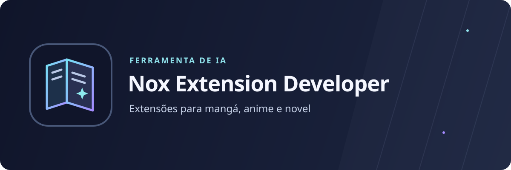

[Português (Brasil)](README.md) | [English](README.en.md)

<p align="center"></p>

# Nox Extension Developer

**A skill for creating, fixing, and reviewing manga, anime, and novel extensions with agent assistance.** Consult each ecosystem's official references before changing code.

[Português](README.md) · [Guide](docs/en/guide.md) · [Security](SECURITY.md) · [Compatibility](COMPATIBILIDADE.md)

[](LICENSE) [](https://github.com/Awerkori/nox-extension-developer/releases) [](https://github.com/Awerkori/nox-extension-developer/actions/workflows/ci.yml)

**Navigation:** [Ecosystems](#ecosystems) · [Installation](#installation) · [Dependencies](docs/en/dependencies.md) · [Android SDK](docs/en/android-sdk.md) · [Examples](#examples) · [Community](#community-and-license)

## Ecosystems

| Content | Reference app | Source project | Typical output |
|---|---|---|---|
| Manga | [Mihon](https://mihon.app/) and compatible apps | [Keiyoushi](https://github.com/keiyoushi/extensions-source) | Extension APK |
| Anime | [Aniyomi](https://aniyomi.org/) and compatible apps | [Yuzono](https://github.com/yuzono/anime-extensions) | Extension APK |
| Novels | [LNReader](https://github.com/LNReader/lnreader) | [LNReader plugins](https://github.com/LNReader/lnreader-plugins) | JavaScript plugin bundle |

Formats and compatibility depend on app and repository versions. This skill does not distribute third-party APKs or bundles.

## Compatibility

| Environment | Status |
|---|---|
| OpenCode + Arch Linux | Tested |
| OpenCode + other Linux distributions | Not validated |
| OpenCode + Windows/macOS | Not tested; native Windows requires WSL for current scripts |
| Codex, Claude Code, Google Antigravity, Hermes Agent and others | Not tested |

Agent Skills is a shared format, not a compatibility guarantee. See [details](COMPATIBILIDADE.md) and [dependencies](docs/en/dependencies.md).

## Capabilities

- Create, fix, maintain, migrate, or review sources, including from natural-language requests.
- Consult official documentation per ecosystem and guide catalog, search, detail, and content analysis.
- Compare supplied API contracts and request approval before risky migrations or scope expansion.
- Guide targeted tests and builds, preserving the local API when appropriate.

## Installation

### Skills CLI

```sh
npx skills add Awerkori/nox-extension-developer
```

To install globally for OpenCode: `npx skills add Awerkori/nox-extension-developer --global --agent opencode`. NPX installs the skill, not the Android SDK or development dependencies.

Installation from the public repository and loading the installed copy were verified on OpenCode + Arch Linux using `skills` 1.8.1. Listing may show `Agents: not linked` for a universal installation in `.agents/skills` even when OpenCode discovers the skill. Check in a new session; this does not guarantee discovery across agents.

### Local OpenCode installation

Obtain a trusted copy in a permanent directory and enter the folder containing `SKILL.md`. The installer creates a link to that folder; do not move it while the link is in use.

```sh
mkdir -p ~/.config/opencode/skills
python3 scripts/install.py opencode
```

The installer does not replace existing destinations. For other platforms, first check [COMPATIBILIDADE.md](COMPATIBILIDADE.md): paths are prepared but untested. Do not install dependencies or accept licenses without authorization.

### Copyable installation prompt

Paste this prompt into your preferred agent:

```text
Help me install Nox Extension Developer from https://github.com/Awerkori/nox-extension-developer. Identify my operating system and agent, consult official installation instructions, and ask which ecosystems I want to use. Check existing tools and prefer npx skills add Awerkori/nox-extension-developer. Configure only needed dependencies, including the Android SDK only when applicable. Ask permission before consequential changes, privileged operations, or accepting licenses; do not overwrite settings or expose credentials. Verify installation and discovery in a new session, then explain how to start and what was not tested.
```

Full versions: [English prompt](prompts/install-en.txt) · [prompt em português](prompts/install-pt-BR.txt).

## Dependencies and verification

- Local installation: Python 3 and an existing platform skills directory.
- Reference updates: Python 3, Git, HTTPS, and access to the official repositories. Offline use requires a previously obtained, integrity-checked snapshot.
- Keiyoushi or Yuzono builds: Java, Android SDK, and components required by the target repository. LNReader: Node.js and dependencies required by the target project. Check versions before installation or building.

Open a new OpenCode session and explicitly ask `Use nox-extension-developer`. Confirm that the agent loaded `SKILL.md`; automatic selection is not guaranteed. To fetch references and run local tests from the skill directory:

```sh
python3 scripts/references.py sync keiyoushi
python3 scripts/references.py sync yuzono
python3 scripts/references.py sync lnreader
python3 -m unittest discover -s tests -v
```

## Examples

Creation and repair, respectively:

```text
Create a manga extension following the Keiyoushi standard for Mihon for this site: [URL].
Fix this extension following the Keiyoushi standard: [CODE LINK]. Chapters do not appear and pages do not load.

Create an anime extension following the Yuzono standard for Aniyomi for this site: [URL].
Fix this extension following the Yuzono standard: [CODE LINK]. Episodes do not load and videos do not play.

Create a novel extension for LNReader for this site: [URL].
Fix this LNReader extension: [CODE LINK]. Search returns no results and chapters do not load.
```

- `Use nox-extension-developer to fix this Keiyoushi extension without migrating its API.`
- `Use nox-extension-developer to review video resolution for this Yuzono source.`
- `Use nox-extension-developer to create an LNReader plugin for <URL>, respecting the site's rules.`

## References and offline cache

At the start of each task, `scripts/references.py` resolves the official HEAD with `git ls-remote` and obtains required documents pinned to that commit. The manifest records URLs, commit, retrieval time, and SHA-256 hashes. If the commit has not changed, the script checks and reuses the local snapshot. A new commit requires manual API compatibility review, even if required documents did not change. The script does not update in the background.

The cache lives at `${XDG_CACHE_HOME:-~/.cache}/opencode/nox-workspace/nox-extension-developer/`. Network failures can return a complete, integrity-checked snapshot marked `offline_or_unverified`; it may be stale. Without an intact snapshot, the lookup fails. Partial updates do not replace the previous snapshot; history and quarantine are not cleaned automatically. Hashes detect accidental corruption but do not authenticate a fully tampered cache.

## Security, permissions, and rights

Remote documents and site pages are untrusted data. The reference script does not execute commands contained in them; agent instructions are not a sandbox or a guarantee against prompt injection. Use least privilege, protect credentials, and apply suitable isolation. Request authorization before installing dependencies, changing permissions, accessing private data, or testing real sites. Respect site licenses, copyright, terms, and access controls; this skill grants no access or distribution rights.

## Architecture and limitations

- [`SKILL.md`](SKILL.md): agent instructions and workflow.
- [`scripts/references.py`](scripts/references.py): snapshot synchronization and verification.
- [`scripts/api_compare.py`](scripts/api_compare.py) and [`references/api-contracts.md`](references/api-contracts.md): limited comparison of supplied contracts.
- [`scripts/install.py`](scripts/install.py): local installation by symbolic link; `tests/`: local tests.

Only local OpenCode on Linux has had installation and loading verified. Codex, Claude Code, Antigravity, and Windows are untested. API identification depends on agent analysis; declaration comparison is heuristic and does not prove semantic compatibility. Builds and tests using synthetic data do not prove functionality on real sites or APIs. Build and test the authorized target before claiming it works.

## Troubleshooting and removal

- **Skill missing:** check the destination reported by the installer. For OpenCode, the local installer uses `~/.config/opencode/skills/nox-extension-developer`; the `skills` CLI can use `.agents/skills/nox-extension-developer` in the project or user directory. Check `SKILL.md` and permissions, open another session, and invoke the skill explicitly.
- **`offline_or_unverified`:** check network and repository access; the available snapshot may be stale.
- **No intact snapshot:** restore access and synchronize again. Do not modify code based on unknown rules.
- **Destination exists:** inspect it; the installer does not overwrite files or links.

For a CLI installation, run `npx skills remove nox-extension-developer` and review its options; add `--global` if installed globally. For the symlink installer, confirm the target and remove only that link. Keep the original directory and cache while needed; do not delete them automatically.

## Community and license

Read [CONTRIBUTING.en.md](CONTRIBUTING.en.md) and [CODE_OF_CONDUCT.md](CODE_OF_CONDUCT.md). Use [issues](https://github.com/Awerkori/nox-extension-developer/issues) for bugs and proposals and [discussions](https://github.com/Awerkori/nox-extension-developer/discussions) for questions. For vulnerabilities, see [SECURITY.md](SECURITY.md) and use GitHub private reporting.

License: **AGPL-3.0-only**, as stated in [LICENSE](LICENSE). Third-party references retain their own licenses; see [ATRIBUICOES.md](ATRIBUICOES.md). Project Nox is not affiliated with the projects cited.

Official references: [Agent Skills](https://agentskills.io/) · [OpenCode skills](https://opencode.ai/docs/skills/) · [Keiyoushi](https://github.com/keiyoushi/extensions-source) · [Yuzono](https://github.com/yuzono/anime-extensions) · [LNReader plugins](https://github.com/LNReader/lnreader-plugins).
