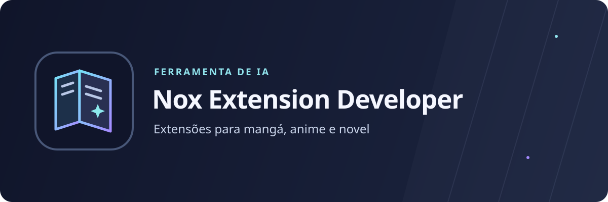

[Português (Brasil)](README.md) | [English](README.en.md)

<p align="center"></p>

# Project Nox · Extension Developer

Uma **skill gratuita e de código aberto** que ajuda sua IA a criar, corrigir e atualizar extensões. Você descreve o que precisa; a IA consulta as referências oficiais, analisa o site e orienta o desenvolvimento, os testes e a compilação.

| Conteúdo | Padrão | Aplicativo | Resultado |
|---|---|---|---|
| 📚 Mangá | Keiyoushi | Mihon e forks | APK |
| 🎬 Anime | Yuzono | Aniyomi e forks | APK |
| 📖 Novel | LNReader | LNReader | Plugin / bundle |

O Project Nox não é afiliado aos projetos de referência. Use apenas sites e conteúdos que você tenha autorização para acessar. A skill auxilia o desenvolvimento, mas não garante funcionamento em qualquer site.

## 📦 Dependências necessárias

| Ferramenta | Para que serve | Quando instalar |
|---|---|---|
| Git | Consulta repositórios oficiais | Para usar as referências |
| Python 3 | Executa os scripts da skill | Para usar os scripts |
| Node.js, npm e NPX | Instalam a skill pelo terminal | Para o método NPX; Node também é necessário para LNReader |
| Java JDK | Compila código Kotlin | Para mangá e anime, na versão exigida pelo projeto |
| Android SDK, Command-line Tools, plataforma e Build Tools | Preparam e compilam APKs | Para mangá e anime, conforme o projeto |
| Dependências do LNReader e TypeScript | Desenvolvem plugins de novels | Para novels; use as versões do próprio projeto |
| ADB e emulador | Testam em dispositivo Android | Opcionais quando não houver teste em dispositivo |

> **NPX instala a skill, não Java, Android SDK ou as demais ferramentas de desenvolvimento.**
>
> **Para desenvolver somente novels para LNReader, você não precisa instalar o Android SDK.**

O Gradle Wrapper e outras ferramentas podem acompanhar o projeto. Não é necessário instalá-las globalmente. Veja o [guia de dependências](docs/pt-BR/dependencias.md).

## 💻 Instalação das dependências

Abra a seção do seu sistema. Instale apenas ferramentas ausentes e peça ajuda à IA se algum comando falhar. Operações com `sudo` pedem senha e alteram o computador.

<details><summary>🐧 Arch Linux</summary>

Abra o Terminal e execute:

```bash
sudo pacman -S --needed git python nodejs npm
```

Para mangá ou anime, instale o JDK exigido pelo projeto, por exemplo `sudo pacman -S --needed jdk21-openjdk` quando ele exigir Java 21. Depois siga o [guia Android SDK](docs/pt-BR/android-sdk.md), que contém o bloco completo de instalação e revisão de licenças.

</details>

<details><summary>🐧 Ubuntu ou Debian</summary>

Abra o Terminal e execute:

```bash
sudo apt update
sudo apt install git python3 nodejs npm
```

Para mangá ou anime, instale a versão de JDK exigida pelo projeto pelos repositórios da sua distribuição e siga o [guia Android SDK](docs/pt-BR/android-sdk.md). Procedimento não testado nesta distribuição.

</details>

<details><summary>🐧 Fedora</summary>

Abra o Terminal e execute:

```bash
sudo dnf install git python3 nodejs npm
```

Para mangá ou anime, instale o JDK exigido pelo projeto e siga o [guia Android SDK](docs/pt-BR/android-sdk.md). Procedimento não testado nesta distribuição.

</details>

<details><summary>🪟 Windows</summary>

Os scripts de referências da skill dependem de recursos Linux. Abra o PowerShell e instale o [WSL](https://learn.microsoft.com/windows/wsl/install) com `wsl --install`; reinicie se solicitado. Abra o Ubuntu pelo menu Iniciar e siga as instruções de Ubuntu acima **dentro do WSL**. Instale sua IA no mesmo ambiente e siga o [guia Android SDK](docs/pt-BR/android-sdk.md) quando necessário. Windows/WSL não foi homologado.

</details>

<details><summary>🍎 macOS</summary>

Abra o Terminal. Instale [Git](https://git-scm.com/downloads), [Python 3](https://www.python.org/downloads/) e [Node.js](https://nodejs.org/en/download) pelos instaladores oficiais. Para mangá ou anime, instale um [JDK](https://openjdk.org/install/) compatível e siga o [guia Android SDK](docs/pt-BR/android-sdk.md). Procedimento não testado no macOS.

</details>

Verifique as ferramentas instaladas no terminal:

```bash
git --version
python3 --version
node --version
npm --version
```

Para mangá ou anime, verifique também `java -version`, `javac -version` e `sdkmanager --list`. As versões Android dependem do projeto; não aceite licenças sem revisá-las. [Instruções detalhadas e solução de problemas](docs/pt-BR/guia.md).

## 📥 Como instalar a skill

### Método 1 — terminal

Abra um terminal e execute:

```bash
npx skills add Awerkori/nox-extension-developer
```

Escolha sua IA quando o instalador perguntar. Para instalar globalmente no OpenCode:

```bash
npx skills add Awerkori/nox-extension-developer --global --agent opencode
```

Abra uma nova sessão da IA e peça: `Use a skill nox-extension-developer`. Confira se ela informa que carregou a skill. Para instalar em outro agente, consulte as opções de `npx skills add --help` e escolha o identificador correspondente. O instalador e as cópias locais podem usar pastas diferentes; consulte o destino informado na tela.

### Método 2 — peça à sua IA ⭐

Abra sua IA agêntica, copie o texto abaixo, envie e autorize apenas as operações com as quais concordar:

```text
Instale e configure a skill Nox Extension Developer:
https://github.com/Awerkori/nox-extension-developer

Consulte a documentação oficial e identifique meu sistema operacional e minha IA. Pergunte se desejo trabalhar com mangá, anime, novels ou todos. Verifique as ferramentas existentes e instale somente as necessárias, incluindo Java e Android SDK apenas quando aplicável. Solicite minha autorização antes de instalações, operações administrativas ou aceite de licenças. Não sobrescreva configurações nem exponha credenciais. Instale a skill via NPX, confirme sua descoberta em uma nova sessão e explique como criar, corrigir ou atualizar uma extensão.
```

[Baixar prompt em português](prompts/install-pt-BR.txt) · [English prompt](prompts/install-en.txt) · [Instalação manual](docs/pt-BR/guia.md#instalação)

## 🚀 Como utilizar na prática

Substitua os textos entre colchetes pelo endereço do site ou do código.

### 📚 Mangá — criar
```text
Crie uma extensão de mangá seguindo o padrão Keiyoushi para o Mihon deste site: [URL DO SITE].
```

### 📚 Mangá — corrigir
```text
Corrija esta extensão seguindo o padrão Keiyoushi: [LINK DO CÓDIGO].

Os capítulos não aparecem e as páginas não carregam.
```

### 🎬 Anime — criar
```text
Crie uma extensão de anime seguindo o padrão Yuzono para o Aniyomi deste site: [URL DO SITE].
```

### 🎬 Anime — corrigir
```text
Corrija esta extensão seguindo o padrão Yuzono: [LINK DO CÓDIGO].

Os episódios não carregam e os vídeos não reproduzem.
```

### 📖 Novel — criar
```text
Crie uma extensão de novel para o LNReader deste site: [URL DO SITE].
```

### 📖 Novel — corrigir
```text
Corrija esta extensão para o LNReader: [LINK DO CÓDIGO].

A pesquisa não funciona e os capítulos não carregam.
```

Para atualizar uma extensão, envie seu código e peça à IA que preserve a compatibilidade. Peça o caminho do APK ou bundle e instruções para testá-lo. Revise o resultado e use somente fontes autorizadas.

## 🤖 Compatibilidade com IAs agênticas

| Agente | Status |
|---|---|
| [OpenCode](https://opencode.ai/) | ✅ Testado |
| [Codex](https://developers.openai.com/codex/) | ⚪ Não testado |
| [Claude Code](https://code.claude.com/) | ⚪ Não testado |
| [Google Antigravity](https://antigravity.google/) | ⚪ Não testado |
| [Hermes Agent](https://github.com/NousResearch/hermes-agent) | ⚪ Não testado |

A skill foi desenvolvida e testada com OpenCode no ambiente Arch Linux do desenvolvedor. Outros agentes e sistemas podem ser compatíveis, mas não foram homologados.

## ❓ Perguntas frequentes

**Preciso saber programar?** Não para começar, mas revisar e manter extensões pode exigir ajuda técnica.

**A skill é gratuita? Preciso pagar pela IA?** A skill é gratuita. Custos e cotas dependem do agente e do modelo escolhidos.

**Preciso instalar uma IA local?** Não necessariamente; depende do serviço que você usar.

**Preciso do Android SDK?** Para compilar APKs de mangá ou anime, sim. Para apenas LNReader, não.

**Posso usar para criar ou corrigir extensões próprias e contribuir?** Sim, respeitando os direitos e regras dos sites e projetos envolvidos.

**Minha IA não reconheceu a skill.** Abra uma nova sessão, peça seu nome explicitamente e confira o destino informado pelo instalador. Veja [solução de problemas](docs/pt-BR/guia.md#solução-de-problemas).

**Como atualizo ou removo?** Consulte a CLI com `npx skills update --help` ou `npx skills remove --help`; para o instalador manual, preserve a pasta de origem e confira o link antes de removê-lo.

## 🤝 Suporte e contribuições

- [Issues](https://github.com/Awerkori/nox-extension-developer/issues): reporte problemas reproduzíveis.
- [Discussions](https://github.com/Awerkori/nox-extension-developer/discussions): tire dúvidas e compartilhe ideias.
- [Pull Requests](https://github.com/Awerkori/nox-extension-developer/pulls): envie melhorias; leia [como contribuir](CONTRIBUTING.md).
- [Releases](https://github.com/Awerkori/nox-extension-developer/releases): acompanhe atualizações.

Nunca publique senhas, tokens ou dados pessoais. Para vulnerabilidades, use o canal descrito em [SECURITY.md](SECURITY.md).

## 🔗 Projetos relacionados

- [Plataforma Web de Mangá](https://github.com/Awerkori/project-nox-manga) — leitor e plataforma web.
- [Importer](https://github.com/Awerkori/project-nox-importer) — importação de conteúdo.
- [Extensões de Mangá](https://github.com/Awerkori/manga-extensoes) · [Código-fonte](https://github.com/Awerkori/manga-fonte-extensoes).
- [Extensões de Anime](https://github.com/Awerkori/anime-extensoes) · [Código-fonte](https://github.com/Awerkori/anime-fonte-extensoes).
- [Central de Pedidos](https://github.com/Awerkori/project-nox-requests) · [Tracker](https://github.com/Awerkori/project-nox-tracker).

## 🌟 Créditos e reconhecimento

Criado por **Awerkori** para o **Project Nox**, com agradecimento à comunidade e aos colaboradores. [Keiyoushi](https://github.com/keiyoushi/extensions-source), [Yuzono](https://github.com/yuzono/anime-extensions), [LNReader](https://github.com/LNReader/lnreader-plugins) e o padrão [Agent Skills](https://agentskills.io/) são referências técnicas independentes. Consulte [atribuições](ATRIBUICOES.md).

## ⚖️ Licença e Copyright

Copyright © 2026 Awerkori. Software livre sob **GNU Affero General Public License versão 3.0 (`AGPL-3.0-only`)**. Leia o texto integral em [LICENSE](LICENSE).

> This program is free software: you can redistribute it and/or modify it under the terms of the GNU Affero General Public License, version 3. It is distributed WITHOUT ANY WARRANTY; without even the implied warranty of MERCHANTABILITY or FITNESS FOR A PARTICULAR PURPOSE.

### 📌 Interação Remota de Rede (GNU AGPLv3 Seção 13)

Ao modificar o programa e permitir interação remota pela rede, ofereça aos usuários remotos acesso ao código-fonte correspondente da versão modificada, conforme a seção 13 da licença.

### 🛡️ Proteção de Identidade e Marca (AGPLv3 Seção 7(e))

A licença do software não concede automaticamente autorização para usar nomes ou logotipos do Project Nox e Awerkori para insinuar representação, aprovação ou endosso oficial.

### 🌐 Utilização e Redistribuição

Você pode usar, estudar, modificar e redistribuir a skill gratuitamente, observando os termos da AGPLv3 e as licenças de terceiros aplicáveis.

### ⚖️ Isenção de Responsabilidade

A skill auxilia o desenvolvimento; ela não concede direitos sobre conteúdo de terceiros nem garante o funcionamento das extensões. O programa é fornecido sem garantias, conforme a licença.
